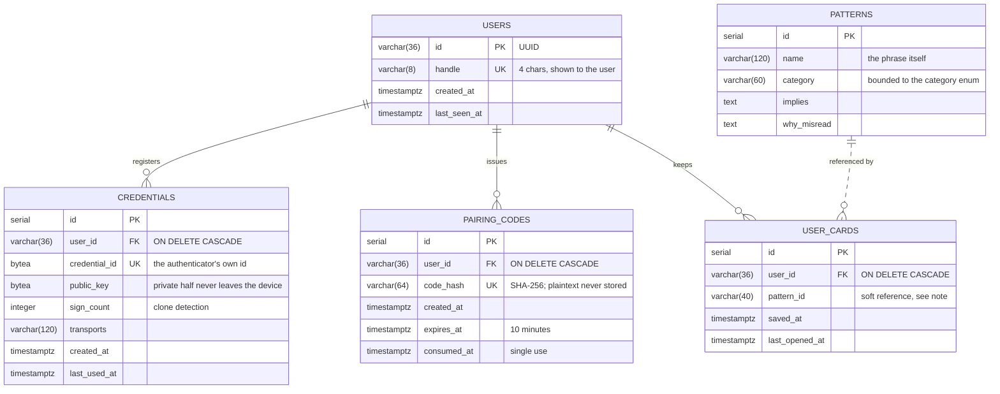

# Database schema

Five tables. One holds content the team wrote; the other four hold accounts
and what an account carries between devices. No table holds message text -
see [api-contract.md](api-contract.md), "Data retention".

Kept in step with `backend/app/models/` by hand. To check it against a live
database, see "Verifying this" at the bottom.



## Notes a reader will ask about

**`USER_CARDS.pattern_id` is not a foreign key.** It is a string holding the
id the patterns API hands out, and the dashed line says so. The library is
curated content that gets reseeded and renumbered between iterations, and a
hard constraint would mean a reseed could fail or silently delete someone's
saved cards. The cost is that a card can outlive its pattern; the sync code
skips a row whose pattern no longer exists rather than building a card with
no content.

**No table stores a message.** Decodes, drafts and the cards made from them
live in the browser's `localStorage`. `USER_CARDS` is the only user-owned
row that crosses devices, and it carries a pattern id and two timestamps -
nothing anyone typed.

**Deleting a user removes everything of theirs.** Every child table is
`ON DELETE CASCADE`, and the ORM also deletes children itself rather than
relying on the database to do it: SQLite (used by the test suite) does not
enforce foreign keys by default, and that gap once left credentials behind.

**`PATTERNS` has no owner.** It is the same rows for everybody - the pattern
library - and nothing in it is personal.

## Verifying this against the running database

The schema that matters is whatever Alembic actually created. From the repo
root, with the Postgres container running:

```sh
# Which migrations have been applied
docker exec -it readtheroom-db psql -U user -d readtheroom -c "select * from alembic_version;"

# Every table and its columns
docker exec -it readtheroom-db psql -U user -d readtheroom -c "\d+ users"
docker exec -it readtheroom-db psql -U user -d readtheroom -c "\d+ credentials"
docker exec -it readtheroom-db psql -U user -d readtheroom -c "\d+ pairing_codes"
docker exec -it readtheroom-db psql -U user -d readtheroom -c "\d+ user_cards"
docker exec -it readtheroom-db psql -U user -d readtheroom -c "\d+ patterns"

# Or the whole thing as SQL, which is also what you paste into a diagram tool
docker exec readtheroom-db pg_dump -U user -d readtheroom --schema-only > docs/schema.sql
```

(Substitute the container name, user and database from the `docker run`
line in the README if yours differ.)
